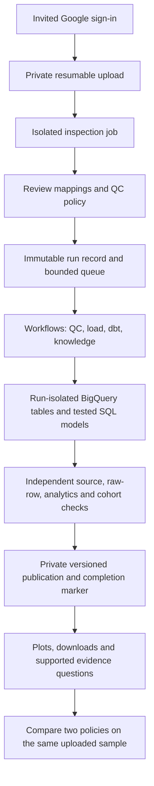

# TraceCell: human and mouse single-cell QC pilot

TraceCell adds uploads, configurable quality control, SQL analytics, evidence-backed
results and policy comparisons to the existing PBMC pipeline. The legacy pipeline
and its archived assistant remain separate.

## Run on your computer

Use Python 3.11. In PowerShell, from the repository root:

```powershell
python -m venv .venv
.\.venv\Scripts\python.exe -m pip install --upgrade "pip>=25.1,<27"
.\.venv\Scripts\python.exe -m pip install --group app --group dev
$env:PYTHONPATH = 'src'
$env:SCRNA_MODE = 'local'
$env:PORT = '8768'
$env:SCRNA_ORIGIN = 'http://127.0.0.1:8768'
.\.venv\Scripts\python.exe -m ops.prepare_app_examples
.\.venv\Scripts\python.exe -m pbmc_platform.app.web
```

Open **http://127.0.0.1:8768**. Keep the terminal running; stop it with Ctrl+C.
The local app uses SQLite, private local files and real DuckDB/dbt SQL. It does
not use GCP or require cloud sign-in. Example preparation downloads public data.
Local mode is restricted to loopback and is forbidden inside Cloud Run.

1. Click a human/mouse example button, or upload your own supported `.h5ad`.
2. Wait for inspection to finish, then select the inspected upload.
3. Map original counts, gene IDs and gene symbols. Select mitochondrial annotation.
4. Review species, tissue, reference genome, source, attribution and QC thresholds.
5. Confirm the settings and submit. Progress updates automatically.
6. Results open automatically after success. Use **Enlarge** for a white in-app high-resolution viewer, with **Actual size** / **Fit to window** controls, or download each figure as **PNG**, **JPEG** (300 dpi, 2400 x 1620 pixels) or vector **PDF**. The **Count axis scale** selector switches count/gene plots between linear and logarithmic axes; mitochondrial percentages stay linear. All cells are included, with blue for pass and orange for excluded.
7. Under **Compare settings on the same sample**, select your first run and click **Prepare a second run**. Change only QC thresholds, confirm and run again. After success, select the second compatible run and compare the cell counts side by side. Do not re-upload the same file.
8. **Understand these results** explains verified counts, exclusions, settings and validation checks. Technical source references remain available in a collapsed details panel.
9. **Clear finished history** removes finished entries from the visible history list, while retaining files, saved results and comparison access. Use **Show cleared entries** to view them again. Active and blocked operations remain visible.

The PBMC and mouse example policies are demonstration choices, not scientific
recommendations. Comparing technical QC policies does not identify an optimal
biological analysis.

## Local port configuration

The default local port is **8768**. Both the frontend and backend use this port;
the API explorer is at **http://127.0.0.1:8768/docs**.

If startup reports `Errno 10048` or "address already in use", stop the existing
server with **Ctrl+C** in its terminal. To use another port instead, set both
variables before starting the app, for example:

```powershell
$env:PYTHONPATH = 'src'
$env:SCRNA_MODE = 'local'
$env:PORT = '8769'
$env:SCRNA_ORIGIN = 'http://127.0.0.1:8769'
.\.venv\Scripts\python.exe -m pbmc_platform.app.web
```

Open **http://127.0.0.1:8769** for this example. On macOS/Linux, use
`export PORT=8769` and `export SCRNA_ORIGIN=http://127.0.0.1:8769`.
When `SCRNA_ORIGIN` is unset, the local origin automatically follows `PORT`.
If it is set, its scheme, host and port must match the URL used in your browser
so uploads and other write requests pass the origin check.

## Supported data and limits

- Public human or mouse research data; one sample per file. No confidential or
  patient-identifiable information, mixed-species matrices or combined analysis.
- Sparse, original, finite, nonnegative integer counts in `X` or a named layer.
  Dense, normalized-only and `raw.X` inputs are not supported in this release.
- Count totals must remain within exact float64 integer precision (at most `2**53 - 1`).
- Unique cell barcodes and original gene identifiers. Gene symbols may repeat.
- Mitochondrial mapping through a non-null boolean column or confirmed symbol
  prefix. Human `MT-` and mouse `mt-` are suggestions, not species detection.
- 250 MiB, 20,000 cells, 40,000 genes and 10 million stored matrix entries.
- Five invited users, ten retained uploads per user and five processing runs per
  user per UTC day on the hosted pilot. The loopback development account (`local-researcher`) has no daily QC run limit for owner testing. One inspection/processing operation runs at a time.
- Access expires after 30 days; daily cleanup removes app objects and tables.
  GCS lifecycle deletion after 35 days is a fallback. Provider time-travel/log
  retention is separate from application access and deletion.

The API cannot verify the truth of user-declared species/tissue/sample metadata.
These limits bound the pilot; they are not a claim of universal `.h5ad` support.

## Data flow



Firestore stores owners, statuses and transactionally guarded admission. GCS
stores generation/checksum-pinned input and output objects. BigQuery datasets
are provisioned once; per-run table suffixes prevent submissions mixing data.
In GCP, publication remains pending until the dispatcher confirms the owning
workflow succeeded and rechecks its bundle. Inspection also waits for terminal
workflow success before becoming ready. The new knowledge schema is version 2 and does not change the PBMC v1 contract.

## Example data and evidence

| Example | Cells | Features | Passing / failing under example policy |
| --- | ---: | ---: | ---: |
| Human PBMC3k | 2,700 | 32,738 | 2,638 / 62 |
| Mouse E18 brain, 10x v3 | 1,301 | 31,053 | 1,117 / 184 |

Both are 10x Genomics public datasets, CC BY 4.0. The mouse input is the filtered,
unnormalized gene-expression matrix converted to `.h5ad` without normalization
or cell subsampling. Source URLs, checksums, exact sizes, mappings and conversion
versions are recorded in [the example catalog](examples/app-datasets.json).

Both real inputs completed QC, SQL/dbt and independent validation locally. Each
build passed six models and 30 data tests. Changing the PBMC mitochondrial cutoff
from 5% to 10% increased passing cells from 2,638 to 2,689, with 51 newly passing
cells. [Portable acceptance evidence](examples/app-acceptance.json) records the
scope and report checksum. Local observations do not establish cloud capacity,
security certification or clinical validity.

## GCP deployment and sign-in

The app uses project **pbmc-okf-portfolio** and that project's linked billing
account. Invited users do not bring GCP accounts or credentials. Dedicated app
service accounts perform processing; users access results through the backend.

[infra/app/](infra/app/) is a separate Terraform root with a separate state prefix
`terraform/app-pilot`. It provisions dedicated app storage, Firestore database,
BigQuery datasets, five worker jobs, API service, workflow, private alert policy
and initially paused dispatcher/cleanup schedules. It does not replace the
legacy deployment. Images must be pinned by digest.

Cloud login requires these operator configuration steps before opening access:

1. Add the existing GCP project in Firebase Console and enable Google as an
   Authentication sign-in provider. Select the support email.
2. Register a Firebase web app and obtain its **public** SDK configuration. Never
   put OAuth client secrets or service account keys in the repository/browser.
3. Authorize the exact deployed app hostname in Firebase Authentication settings.
4. Set `firebase_config`, `invited_emails` and `app_origin` in the ignored app
   Terraform variables. Configure GCS CORS to the same origin through Terraform.
5. Complete the private backend/cloud checks first. With the provider, exact
   origin and owner-only allowlist configured, set `publish_login=true` to make
   the sign-in frontend reachable. Data API routes still require an invited
   session; internal routes also verify the dedicated Scheduler identity.
6. Verify the owner login, add a second invited tester, and check uninvited
   rejection, cross-owner isolation, real processing and deletion. Then enable
   the remaining invitations and unpause the two schedules. Revert
   `publish_login=false` if login acceptance fails.

The API account can create session cookies and inspect revocation, but cannot
administer users or send email through the session role. Alert delivery uses the
existing private Monitoring/Pub/Sub inbox; human receipt is not guaranteed.

## Failure recovery and deletion

Failed or uncertain operations retain their processing slot. Diagnose the exact
workflow execution and all five app jobs before recovery; workflow cancellation
does not automatically stop its tasks. Do not clear the slot based only on age.

```powershell
$env:PYTHONPATH = 'src'
.\.venv\Scripts\python.exe -m pbmc_platform.app.runtime recover --id RUN_OR_UPLOAD_ID --execution EXACT_EXECUTION_ID
```

For local recovery, first stop all app dispatcher processes and add
`--acknowledge-local-processes-stopped`. For cloud recovery, set `SCRNA_MODE=cloud`,
`GOOGLE_CLOUD_PROJECT=pbmc-okf-portfolio`,
`SCRNA_BUCKET=pbmc-okf-portfolio-scrna-app` and
`SCRNA_WORKFLOW=scrna-app-pipeline`; use an authorized operator's ADC. The helper
requires a failed/cancelled terminal owner and completed Cloud Run tasks. A
recorded pre-admission failed dispatch can also be cleared after those checks;
unknown start outcomes remain blocked for investigation.

After recovery, submit an explicit new run. A new run has a new identity and
isolated outputs; it is not a silent continuation of a failed publication.

Use the app's deletion control to remove an upload and its derived runs. Active
or pending operations block deletion. For operator cleanup, run
`python -m pbmc_platform.app.runtime cleanup` in the configured environment.
Pause/resume admissions with the same module's `pause` and `resume` actions.

## Checks

For the current full test suite, all four interface checks and the native
Windows/Linux/macOS CI matrix, see [Tests and CI](OPERATIONS.md#tests-and-ci).
The acceptance figures below describe the recorded release snapshot.

```powershell
$env:PYTHONPATH = 'src'
.\.venv\Scripts\python.exe -m pytest tests/test_app.py -q
.\.venv\Scripts\python.exe -m ops.check_app_examples
```

Cloud backend processing, Scheduler delivery and disposable-fixture cleanup have
been verified. Hosted-user opening remains gated on Firebase configuration, real
owner sign-in and a second invited user isolation check. Billing export is still required for actual-spend
reporting. Resource/query limits and budget notifications are not a guaranteed
monthly spending cap.

## Accepted implementation status (historical release snapshot)

- **390 Python tests passed**, including malformed inputs, both species,
  idempotency, isolation, workflow-success finalization and partial cleanup retries.
- Real human and mouse GCP pipelines completed with verified publications.
- A real Scheduler/API-admitted PBMC comparison passed: 2,638 versus 2,689
  passing cells, with 51 newly passing cells. Both schedules were restored paused.
- Cleanup ran under the actual API identity and removed only disposable expired
  object/table/view fixtures; accepted datasets remained intact.
- The synthetic 20,000-cell / 40,000-feature / 10-million-entry local test passed.
  It does not establish a cloud SLA or worst-case 250 MiB file performance.
- The local HTTP upload-to-report journey passed. Visual browser review was
  stopped by the user; no screenshot-based verification is claimed.
- Hosted sign-in is **not ready**: the project has not yet been added to Firebase
  and the Google provider is not configured. The deployed app remains private.

See [the release evidence summary](examples/app-acceptance.json) for exact
workflow IDs, publication pins, archived report hashes and remaining launch gates.


## Run Evidence questions and research-paper references

The results screen includes a natural-language question box. The assistant reads
selected facts from the checksum-verified Run Evidence package,
plus relevant excerpts from an optional paper belonging to that run. It receives
no raw expression matrix or cell-barcode list. Source links distinguish verified
QC facts, paper passages and AI interpretation. The model cannot execute tools,
change thresholds or start processing. AI wording is not independently verified;
check its cited evidence. Unsupported citations are rejected.

The app supports OpenAI `gpt-5-nano` and a local Ollama model. Neither is bundled
or activated automatically. With no model configured, the question box clearly
provides a **verified evidence lookup**, not a generated NLP answer. Paper upload,
manual rule confirmation and numeric comparison work without any model.

For hosted answers, add the following to your existing ignored `.env` file in the
repository root (do not overwrite other settings and do not send your key in chat):

```dotenv
SCRNA_LLM_PROVIDER=openai
SCRNA_LLM_MODEL=gpt-5-nano
OPENAI_API_KEY=your-own-key
```

Refresh the browser after editing. Only the local app reads `.env`; cloud deployments
must inject the key server-side using Secret Manager. No key is sent to the browser.
Hosted requests require the sharing checkbox and use the app owner's OpenAI API
account. They send the question, selected QC facts, and relevant selected paper
excerpts; `store=False` is set on Responses requests. This is not a claim of zero
provider retention. The app caps model requests at 30 per user per UTC day, including
failed provider attempts. No model calls are made until a user asks or requests rule
suggestions. Existing GCP pipeline billing is separate.

For local answers, install Ollama separately, download the selected model, and start
its local server. Example configuration (also in `examples/model.env.example`):

```dotenv
SCRNA_LLM_PROVIDER=ollama
SCRNA_LLM_MODEL=qwen2.5:3b
SCRNA_OLLAMA_URL=http://127.0.0.1:11434
```

For example, `ollama pull qwen2.5:3b` downloads the weights. A running server and
sufficient local memory are required. The default local endpoint is loopback-only;
a configured status does not claim that the model is already connected or downloaded.

To compare against a paper:

1. Open a successful run and expand **Upload a paper and compare its QC rules**.
2. Upload a text-based public PDF you have permission to use: at most 100 MB (100,000,000 bytes),
   40 pages and 80,000 extracted characters. Up to three papers can be retained per
   run. Scanned documents require OCR outside this app.
3. Read the extracted methods text. Ask the model for draft rules, or enter them
   manually. Each supported rule needs its exact quotation, numeric value,
   retention sign, and PDF page. PDF page numbers can differ from printed numbers.
4. Check species/tissue and confirm the rules. The app verifies quoted text and
   numbers, but you are responsible for interpreting retention direction and context.
5. Compare. The app recalculates retained-cell counts and overlap using all cells
   from the published plot arrays. It supports minimum detected genes, maximum
   detected genes and maximum mitochondrial percentage. Unspecified rules are not
   silently inherited; incomplete references and biological mismatches are flagged.
6. Ask the assistant about the calculated comparison. The backend recomputes the
   confirmed rules when supplying that comparison to the model. It never applies
   them to the saved run or claims to reproduce all methods from the paper.

PDF parsing runs in a separate process with time, memory, page and text limits.
Paper PDFs and text are stored privately under their run prefix; access checks
require the owning user and an unexpired run. Removing a paper deletes its files.
Deleting/expiring an upload cleans up its run-linked papers as well. Clearing
processing history keeps papers with the saved results. Model conversations are
not persisted by this app. This is a research pilot, not validation against a
universal or clinical QC standard.

Implementation references: [OpenAI structured outputs](https://developers.openai.com/api/docs/guides/structured-outputs?api-mode=responses),
[GPT-5 nano](https://developers.openai.com/api/docs/models/gpt-5-nano),
[Ollama chat API](https://docs.ollama.com/api/chat), and
[pypdf text extraction](https://pypdf.readthedocs.io/en/stable/user/extract-text.html).

Example buttons reuse an existing matching, checksum-pinned upload rather than creating a new copy each time. Previously saved copies are preserved. **Manage your data** is collapsed by default and labels each saved copy with its upload date and shortened Upload ID, so individual deletion is explicit.


## Explore the backend with Swagger

Open **http://127.0.0.1:8768/docs** for the grouped API explorer. Expand **Health and Session**, select **GET /ready**, choose **Try it out**, then **Execute**, and inspect the JSON response. **GET /api/runs** lists processing status. Parameters, JSON schemas and binary file-upload fields are generated from the actual API routes.

Download the OpenAPI specification at **http://127.0.0.1:8768/openapi.json**.
Swagger assets are served locally. The explorer supplies the existing CSRF header
for same-origin write requests, while all backend validation and access checks
remain active. POST/PUT/DELETE perform real operations, including processing,
model usage or deletion. Cloud docs and schema require an existing invited-user
session; Swagger does not bypass Firebase sign-in.

The self-hosted UI uses official `swagger-ui-dist` 5.34.1 assets (Apache-2.0). Their source, npm package integrity and per-file SHA256 values are recorded in `src/pbmc_platform/app/static/swagger/version.json`; the upstream license is retained alongside the files.


## Processing progress and time estimates

Processing history shows an animated activity bar, a clear Running/Queued/Paused/
Blocked/Completed state, the current step and elapsed time. QC runs have four
steps: cell quality calculation, analysis-table preparation, consistency checks,
and final verification/publication. Status is fetched every five seconds; the
elapsed timer updates locally every second without extra API requests.

Remaining-time ranges use the median duration of successful runs of the same
upload or exact input checksum. Without that history, the UI labels its estimate
as an initial guide. These are approximate ranges, not measured completion
percentages or a processing SLA. Queued runs do not claim a completion countdown;
blocked operations stop the animation. Overruns and delayed backend updates are
shown explicitly, and completed runs display their actual elapsed duration.

## Build the app container

From the repository root, use the `app` target in the shared Dockerfile:

```powershell
docker build --target app -t tracecell-app .
```

This image is configured for the cloud runtime; use the Python command above for
local development. Private parent images require Artifact Registry authentication.
See [container builds](OPERATIONS.md#container-builds) for all targets and drill builds.
Building does not push or deploy the image.
