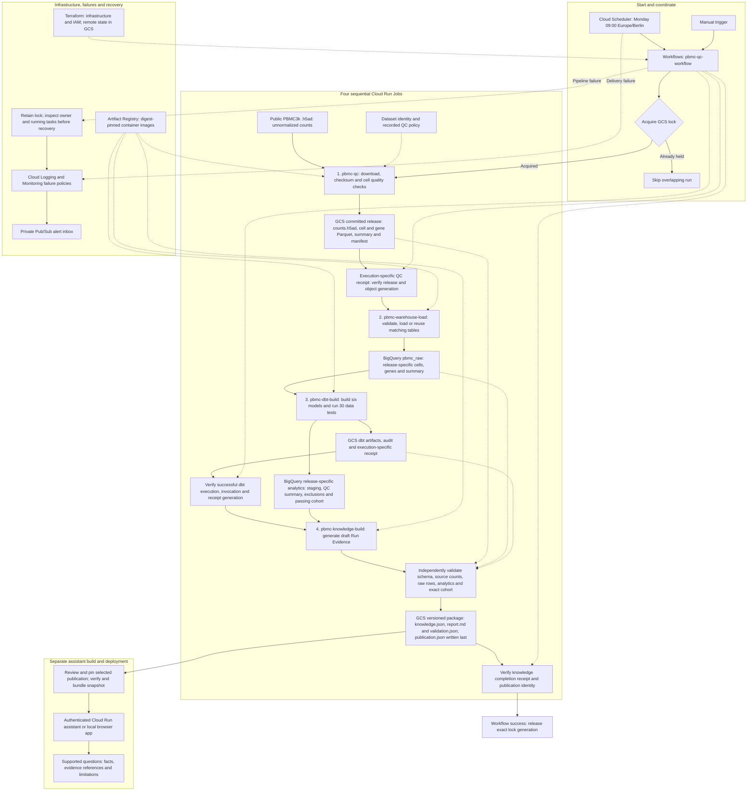

# Operations and the legacy PBMC pipeline

For the current TraceCell app and cross-platform quick start, see the [README](README.md). This guide retains the infrastructure, container and archived PBMC assistant instructions. The scheduled four-job PBMC pipeline is separate from the upload app described in [APP.md](APP.md).

## Complete data pipeline

Solid arrows show processing and delivery. Dotted arrows show orchestration,
evidence inputs and supporting services. Workflows runs the four jobs in order
and checks their completion evidence before continuing.



The assistant keeps its selected snapshot until it is rebuilt and redeployed.
Billing export is a separate reporting path: its BigQuery dataset and cost
reporter are ready, but actual cost records are still pending.

| Step | In simple words | Tool |
| --- | --- | --- |
| 1. Get the data | Download the expected file and check its fingerprint to detect changes. | Python |
| 2. Check quality | Count genes and mitochondrial counts per cell, record pass/fail reasons, and save all cells in a versioned release. | Python, Cloud Storage |
| 3. Load tables | Store cell/gene metadata and summaries; verify matching tables before reusing them on retries. The expression matrix stays outside BigQuery. | Cloud Run Job, BigQuery |
| 4. Build analytics | Turn raw metadata into six useful SQL models and run 30 data tests. | Cloud Run Job, dbt |
| 5. Publish knowledge | Independently check results against source data, then publish JSON facts, a report and validation evidence. | Cloud Run Job, Cloud Storage |
| 6. Answer questions | Serve a selected verified package and show the evidence behind supported answers. | Local Python app or authenticated Cloud Run service |

**Run Evidence** is this project's versioned JSON knowledge package. It
contains facts, source references and limitations; it is not an external standard.
The assistant uses fixed rules, without a language model. New publications require
a separate assistant build and deployment before they change its answers.

## Python dependencies

Maintain dependencies in one file: [pyproject.toml](pyproject.toml). Its groups
include shared groups automatically, so `app` also installs the QC, warehouse
and knowledge dependencies.

| Group | Installs |
| --- | --- |
| `qc` | Scientific QC tools and Cloud Storage client |
| `warehouse` | QC plus BigQuery and dbt |
| `knowledge` | Warehouse plus JSON validation |
| `app` | Knowledge plus web UI, authentication, plots, PDFs and model client |
| `dev` | Testing tools and the local DuckDB dbt adapter; combine with a runtime group |

From the repository root, using Python 3.11:

```powershell
python -m venv .venv
.\.venv\Scripts\python.exe -m pip install --upgrade "pip>=25.1,<27"
.\.venv\Scripts\python.exe -m pip install --group app --group dev
$env:PYTHONPATH = 'src'
```

For QC only, use `--group qc`; for warehouse development, use
`--group warehouse --group dev`. These are standard pip dependency groups, not
package extras: use `--group`, rather than `pip install ".[app]"`. Continue
running the project from its repository root with `PYTHONPATH=src`.

The original exact-version Windows/Python 3.11 snapshots are preserved in
[locks/](locks/README.md). They describe historical QC and warehouse environments;
they are not complete locks for the current app or Linux containers.

## Tests and CI

The [CI workflow](.github/workflows/ci.yml) runs on pushes, pull requests and
manual requests. It tests Python 3.11 on Windows x64, Linux x64, macOS Apple
Silicon and macOS Intel, and runs all four JavaScript checks with Node.js 24.
Each platform finishes independently. No GCP or OpenAI credentials are supplied;
cloud and model integrations use test doubles.

After activating your virtual environment, run these commands from the repository
root on any platform (Node.js 24 is needed for the JavaScript checks):

```text
python -m pip check
python -m pytest -q
node ops/check_app_ui.cjs
node ops/check_app_research_ui.cjs
node ops/check_processing_ui.cjs
node ops/check_swagger_ui.cjs
```

Activate with `.\.venv\Scripts\Activate.ps1` in Windows PowerShell, or
`source .venv/bin/activate` on Linux/macOS. Install the `app` and `dev` dependency
groups first, as described above.

In GitHub Actions, download the `tests-<platform>` artifact for JUnit results,
logs, installed dependency versions and OS/architecture details. Reports are
retained for 14 days, including on test failure. Current results come from these
reports; historical release snapshots are not a current compatibility claim.
The four native platform jobs passed in the [verified CI run](https://github.com/suvrazastrovision/okf_gcp/actions/runs/42281080575). Use the latest workflow results for the current commit.

Version-1 published reports retain their original historical wording because
report bytes, validation receipts and publication pins are checksum-bound.
The current app and documentation call the knowledge package **Run Evidence**.

## Container builds

All components use the root [Dockerfile](Dockerfile). Choose a build target;
without `--target`, Docker builds the original `qc` worker.

| Target | Purpose |
| --- | --- |
| `qc` | Original quality-control worker (default) |
| `qc-workflow` | QC worker with cloud workflow handoff |
| `warehouse` | Warehouse loader and dbt runtime |
| `knowledge` | Generate and verify Run Evidence |
| `assistant` | Archived assistant with its pinned example package |
| `app` | Current TraceCell web app and app worker runtime |
| `drills` | Isolated QC or warehouse recovery testing |
| `knowledge-drills` | Isolated knowledge-publication recovery testing |

From the repository root:

```powershell
docker build --target app -t tracecell-app .
docker build --target warehouse -t tracecell-warehouse .
docker build --target knowledge -t tracecell-knowledge .
```

The `qc`, `warehouse` and `app` targets install groups from `pyproject.toml`.
Other targets retain their verified parent-image dependencies; changing those
requires rebuilding and re-pinning the corresponding parent runtime.

Some targets reuse private, digest-pinned Artifact Registry images. Authenticate
Docker for `europe-west1-docker.pkg.dev` before building those targets:

```powershell
gcloud auth configure-docker europe-west1-docker.pkg.dev
```

The `drills` target defaults to the existing pinned QC parent. To test warehouse
or dbt recovery, supply the pinned warehouse parent explicitly:

```powershell
docker build --target drills --build-arg WORKER_IMAGE=europe-west1-docker.pkg.dev/pbmc-okf-portfolio/pbmc-containers/pbmc-warehouse@sha256:ccb29689345a600fa92123eb91363eb023c8bb4d41d474dd0417b8dd0ddc1398 -t tracecell-drills-warehouse .
```

The root `.dockerignore` allows only required source, configuration and example
references. Drill scripts are copied only into drill targets. Images run as the
non-root `app` user. Building an image does not deploy it or change cloud jobs.

## How the cloud pipeline is managed

- **Workflows** runs four jobs in order: QC, loading, dbt and knowledge. It checks
  receipts linking each stage to the correct release and successful run.
- **Cloud Scheduler** starts the workflow on Mondays at 09:00 Europe/Berlin.
- A **Cloud Storage lock** skips overlapping workflow runs. Failed or cancelled
  runs retain the lock for inspected recovery; cancelling a workflow does not
  automatically stop its Cloud Run tasks.
- **Terraform** defines infrastructure and access permissions. **Artifact
  Registry** stores the container images used by the jobs.
- **Logging, Monitoring and a private Pub/Sub inbox** record failures and deliver alerts.

## Archived assistant demo (PowerShell)

Install **Python 3.11**, open this repository folder in VS Code, and run these
commands in its **PowerShell terminal**. No GCP login or AI API key is needed
for the bundled assistant demo.

```powershell
python -m venv .venv
.\.venv\Scripts\python.exe -m pip install --upgrade "pip>=25.1,<27"
.\.venv\Scripts\python.exe -m pip install --group knowledge
$env:PYTHONPATH = 'src'
.\.venv\Scripts\python.exe -m pbmc_platform.assistant_web
```

Open **http://127.0.0.1:8765** and ask **How many cells passed QC?**
Expected result: **2,638 of 2,700 cells passed QC; 62 failed.**
Keep the terminal running; press **Ctrl+C** to stop. When reopening the project,
run the last two commands again. These commands use the virtual environment
without requiring PowerShell activation.

This demo reads an archived verified result; it does not rerun the cloud pipeline.
You can also read the [verified report](examples/pbmc-verified-report.md) directly.

## Run the processing

To download the configured public input and run QC locally, use the environment
above and run:

```powershell
$env:PYTHONPATH = 'src'
.\.venv\Scripts\python.exe -m pbmc_platform.run_qc
```

The first run needs internet access. Outputs are saved under `data/processed/`
and audit records under `artifacts/`. This runs the acquisition/QC stage only;
it does not load BigQuery or update the assistant snapshot.

To run the full pipeline in the **already provisioned project**, install the
Google Cloud CLI, sign in with an account authorized to run this workflow, then:

```powershell
gcloud auth login
gcloud workflows run pbmc-qc-workflow --project=pbmc-okf-portfolio --location=europe-west1
```

Inspect the execution in Google Cloud Console → Workflows →
`pbmc-qc-workflow`. Cloud runs can incur charges. A different GCP project needs
its own infrastructure, IAM and configuration; the command above is not a fresh
installation. Infrastructure definitions are in [infra/](infra/).

## Deployment portability

To rebuild the README diagram and static badges after changing the flow, run
`.venv/bin/python -m ops.build_pipeline_diagram` (macOS/Linux) or
`.\.venv\Scripts\python.exe -m ops.build_pipeline_diagram` (Windows).

The existing Terraform roots, backend buckets, image references and example cloud commands target the portfolio owner’s `pbmc-okf-portfolio` project. They are not a turnkey deployment into a new user’s account. Configure your own project, state backend, storage, images and IAM before deploying. Several targets use private Artifact Registry parent images; local Python startup does not require them.

Do not commit `.env`, cloud credentials, service-account keys, Terraform state or variable files. Local startup does not create cloud resources. Your own deployed resources can incur charges independently of application use.
