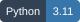
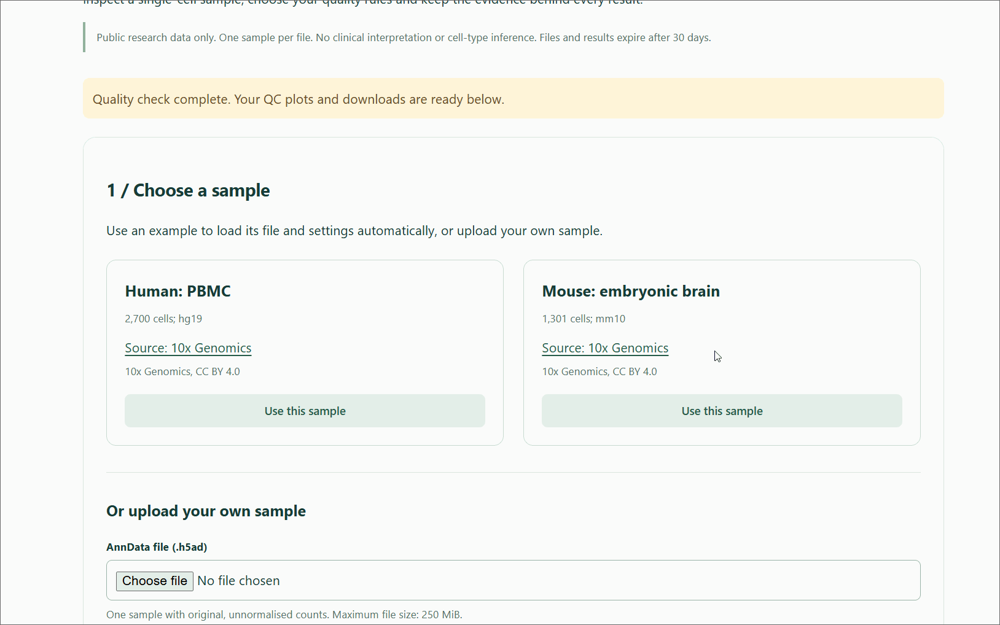

# TraceCell: scRNA-seq Knowledge Platform

[](https://doi.org/10.5281/zenodo.24023343)
[](https://github.com/suvrazastrovision/tracecell/actions/workflows/ci.yml)
[](#quickstart-guide)
[](https://github.com/suvrazastrovision/tracecell/actions/workflows/ci.yml)
[](LICENSE)

[App overview](#app-overview) · [Walkthrough](#walkthrough) ·
[Instructions](#instructions) · [Quickstart guide](#quickstart-guide) · [Licence](#licence)

## App overview

TraceCell is the **quality-control (QC) demonstration module** of a broader
full stack multi-omics application designed to harmonise data and support
**drug target and biomarker discovery**. This repository showcases the
single-cell RNA-seq QC module. **The full application is shared only upon request.**

TraceCell turns a **human or mouse single-cell RNA-seq count matrix** (`.h5ad`)
into quality-control plots, checked SQL analytics and verified Run Evidence.
Review why cells pass or fail, compare QC settings on the same sample, and
compare supported QC rules from a research paper. Recorded settings and source
references make each result reviewable.

This initial research release supports one sample per file. Local QC runs with
one Python server; model-backed answers and GCP deployment are optional.
See the [scope and limitations](APP.md#scope-and-limitations) for details.

## Walkthrough

[](assets/readme/tracecell.gif)

[Open the walkthrough at full size](assets/readme/tracecell.gif).

1. **Choose a sample:** load the human PBMC or mouse brain example, or upload a
   supported `.h5ad` file.
2. **Review and run:** confirm count mappings, sample metadata and QC thresholds,
   then start processing and follow its progress.
3. **Explore results:** inspect the four QC plots and download figures, the report
   and verified evidence.
4. **Compare:** rerun the same sample with different thresholds, or upload a
   text-based paper and confirm its supported QC rules before comparing.
5. **Ask about results:** use verified evidence lookup, or configure an optional
   answering model for cited responses.

## Instructions

Use Python 3.11 and Git. Initial setup needs internet access for dependencies
and public example data. Follow the [quickstart guide](#quickstart-guide), then
choose an example for your first run. For your own data, check the
[input requirements](APP.md#supported-data-and-limits) before uploading.

**Research use only.** Use public, non-identifiable data and review the example
thresholds before applying them. Local QC needs no Node.js, Docker, GCP account
or model API key.

**[Complete documentation](DOCUMENTATION.md)** provides the detailed guides:

| Topic | Guide |
| --- | --- |
| App usage, inputs, plots, comparisons and data management | [App guide](APP.md) |
| Optional answering models and paper QC rules | [Models and paper comparisons](APP.md#run-evidence-questions-and-research-paper-references) |
| Technology, architecture and the cloud pipeline | [Architecture and tooling](OPERATIONS.md#architecture-and-tooling) |
| Dependencies, tests, containers and deployment | [Operations guide](OPERATIONS.md) |
| Example data, validation evidence and release status | [Evidence and release status](DOCUMENTATION.md#evidence-and-release-status) |

## Quickstart guide

Run these commands in a terminal. One Python server serves the frontend and API.

<details open>
<summary><strong>Windows — PowerShell</strong></summary>

```powershell
git clone https://github.com/suvrazastrovision/tracecell.git
cd tracecell
py -3.11 -m venv .venv
.\.venv\Scripts\python.exe -m pip install --upgrade "pip>=25.1,<27"
.\.venv\Scripts\python.exe -m pip install --group app --group dev
$env:PYTHONPATH = 'src'
$env:SCRNA_MODE = 'local'
$env:PORT = '8768'
$env:SCRNA_ORIGIN = 'http://127.0.0.1:8768'
.\.venv\Scripts\python.exe -m ops.prepare_app_examples
.\.venv\Scripts\python.exe -m pbmc_platform.app.web
```

</details>

<details>
<summary><strong>macOS / Linux — Terminal</strong></summary>

```bash
git clone https://github.com/suvrazastrovision/tracecell.git
cd tracecell
python3.11 -m venv .venv
.venv/bin/python -m pip install --upgrade "pip>=25.1,<27"
.venv/bin/python -m pip install --group app --group dev
export PYTHONPATH=src
export SCRNA_MODE=local
export PORT=8768
export SCRNA_ORIGIN=http://127.0.0.1:8768
.venv/bin/python -m ops.prepare_app_examples
.venv/bin/python -m pbmc_platform.app.web
```

</details>

Open the **[frontend](http://127.0.0.1:8768)** or explore the
**[backend API in Swagger](http://127.0.0.1:8768/docs)**.
Keep the terminal running; press **Ctrl+C** to stop.
To restart, open the repo folder, set `PYTHONPATH`, `SCRNA_MODE`, `PORT` and
`SCRNA_ORIGIN` as above, then run the final server command. Installation and
example preparation are one-time setup steps. If the port is occupied, follow
[local port configuration](APP.md#local-port-configuration).

For optional answers, follow [model configuration](APP.md#optional-env-configuration).

## Licence

Original project code is licensed under **AGPL-3.0-only**; see [LICENSE](LICENSE).
Bundled material and example data retain the terms listed in
[third-party notices](THIRD_PARTY_NOTICES.md).

Developed and designed by **Suvra Nath**. Copyright © Suvra Nath, 2026.
