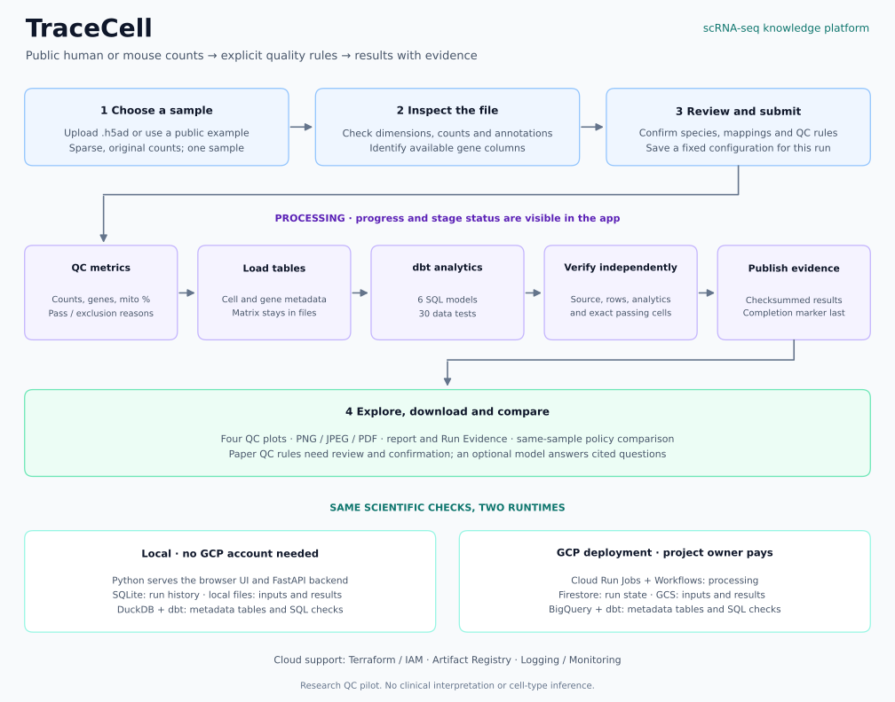

# TraceCell — scRNA-seq Knowledge Platform

[](https://github.com/suvrazastrovision/okf_gcp/actions/workflows/ci.yml)
[](#quick-start)
[](https://github.com/suvrazastrovision/okf_gcp/actions/workflows/ci.yml)
[](LICENSE)

Turn a **human or mouse single-cell RNA-seq sample** into clear quality-control
plots, checked results and evidence you can revisit. Scientists can compare QC
settings on the same sample, see why cells were excluded, and compare supported
QC rules with a research paper. Source links and recorded settings help colleagues
review and reproduce each decision.

## Walkthrough

1. **Choose a sample:** use the human PBMC or mouse brain example to load its file
   and settings automatically, or upload your own `.h5ad`.
2. **Review and run:** check the QC thresholds, confirm the settings and start.
   The progress panel shows the current stage and elapsed time.
3. **Explore results:** enlarge the four QC plots or download them as PNG, JPEG
   or PDF. Download the report and verified evidence too.
4. **Compare:** rerun the same sample with different QC thresholds, or upload a
   text-based paper and confirm its supported QC rules before comparing.
5. **Ask about results:** use verified evidence lookup, or configure an optional
   answering model for cited natural-language responses.

## Quick start

Install **Python 3.11** and **Git**. The first setup needs internet access to
install dependencies and download the public example data.
**One Python server runs both the frontend and backend**; no Node.js, Docker,
GCP account or model API key is needed to run local QC.

<details open>
<summary><strong>Windows — PowerShell</strong></summary>

```powershell
git clone https://github.com/suvrazastrovision/okf_gcp.git
cd okf_gcp
py -3.11 -m venv .venv
.\.venv\Scripts\python.exe -m pip install --upgrade "pip>=25.1,<27"
.\.venv\Scripts\python.exe -m pip install --group app --group dev
$env:PYTHONPATH = 'src'
$env:SCRNA_MODE = 'local'
.\.venv\Scripts\python.exe -m ops.prepare_app_examples
.\.venv\Scripts\python.exe -m pbmc_platform.app.web
```

</details>

<details>
<summary><strong>macOS / Linux — Terminal</strong></summary>

```bash
git clone https://github.com/suvrazastrovision/okf_gcp.git
cd okf_gcp
python3.11 -m venv .venv
.venv/bin/python -m pip install --upgrade "pip>=25.1,<27"
.venv/bin/python -m pip install --group app --group dev
export PYTHONPATH=src
export SCRNA_MODE=local
.venv/bin/python -m ops.prepare_app_examples
.venv/bin/python -m pbmc_platform.app.web
```

</details>

Open the **[frontend](http://127.0.0.1:8767)** or explore the
**[backend API in Swagger](http://127.0.0.1:8767/docs)**.
Keep the terminal running; press **Ctrl+C** to stop.
To restart, open the repo folder, set `PYTHONPATH` and `SCRNA_MODE` as above,
then run the final server command. Installation and example preparation are
one-time setup steps.

## Data pipeline

[](assets/readme/pipeline.svg?raw=true)

**[Open the full-size diagram](assets/readme/pipeline.svg?raw=true)** to zoom:
use **Ctrl + / −** on Windows/Linux or **Cmd + / −** on macOS; **0** with the
same modifier resets the view. Download the SVG if your preview limits zoom.
The [complete scheduled PBMC cloud pipeline](OPERATIONS.md#complete-data-pipeline)
is documented separately.

## Before you use it

- **Input:** one public human or mouse sample per `.h5ad`, with sparse original
  counts in `X` or a named layer. Limits: 250 MiB, 20,000 cells, 40,000 genes and
  10 million stored entries. See [all input requirements](APP.md#supported-data-and-limits).
- **Examples:** [human PBMC3k](https://www.10xgenomics.com/datasets/3-k-pbm-cs-from-a-healthy-donor-1-standard-1-1-0)
  and [mouse E18 brain](https://www.10xgenomics.com/datasets/1-k-brain-cells-from-an-e-18-mouse-v-3-chemistry-3-standard-3-0-0),
  from 10x Genomics, CC BY 4.0. Example thresholds are demonstrations, not universal recommendations.
- **Costs:** cloning and local QC do not use the repository owner's GCP account.
  A cloud deployment uses its project's billing account; an optional paid model
  uses the configured key owner's account. Cloud configuration currently targets
  the portfolio project; [adapt it before deploying your own copy](OPERATIONS.md#deployment-portability).
- **Limits:** research use only; no clinical interpretation, cell-type inference
  or multi-sample analysis. Paper comparison covers supported QC rules, not a
  reproduction of an entire paper. Check AI answers against their cited evidence.

## Further reading

- [App guide](APP.md): parameters, comparisons, optional model setup and data management.
- [Operations guide](OPERATIONS.md): Docker targets, dependencies, cloud pipeline and deployment notes.
- [Tests and CI](OPERATIONS.md#tests-and-ci): local checks and Windows, Linux, Intel Mac and Apple Silicon jobs.

## License

Original project code is **AGPL-3.0-only**. Commercial use is allowed under its
conditions, including source-sharing obligations. See [LICENSE](LICENSE) and
[third-party notices](THIRD_PARTY_NOTICES.md) for the separate licenses of bundled
material and example data.

Copyright © 2026 suvrazastrovision and contributors.
