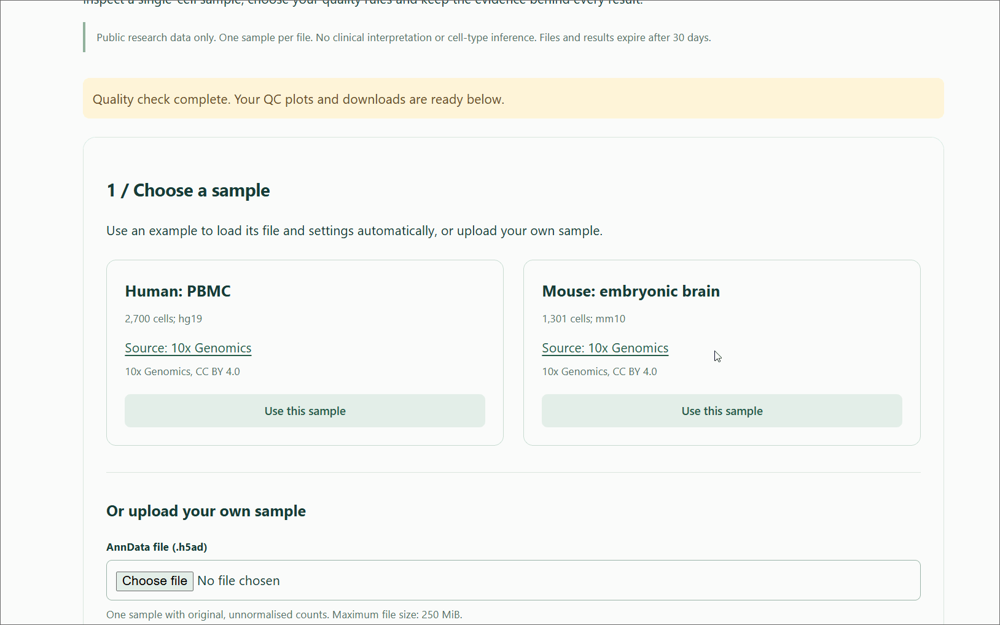
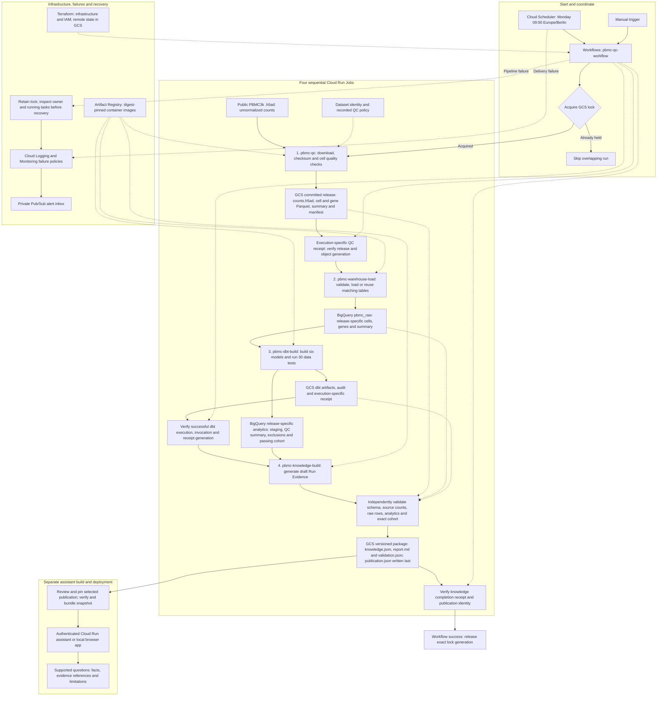

## TraceCell: scRNA-seq Knowledge Platform

[](https://doi.org/10.5281/zenodo.24023343)
[](https://github.com/suvrazastrovision/tracecell/actions/workflows/ci.yml)
[](#quick-start)
[](https://github.com/suvrazastrovision/tracecell/actions/workflows/ci.yml)
[](LICENSE)

Turn a **human or mouse single-cell RNA-seq sample** into clear quality-control
plots, checked results and evidence you can revisit. Scientists can compare QC
settings on the same sample, see why cells were excluded, and compare supported
QC rules with a research paper. Source links and recorded settings help colleagues
review and reproduce each decision.

TraceCell is a **scientific data platform** that connects sample processing with
tested analytics and traceable results. **Terraform** defines the cloud
infrastructure and access permissions, **dbt** builds and tests the SQL analytics,
and **GCP Workflows** coordinates processing and publication. This design supports
the current scope: analysing existing `.h5ad` count matrices within a GCP-based
platform. **Nextflow** would be a strong option for future workflows requiring
large parallel sequencing analyses or execution across HPC and multiple clouds;
it could work alongside Terraform and dbt.

**First release:** this is the initial research version on this data analytics platform. Further features, workflow upgrade, improvements and batch scheduler job of unified integrated MultiOmics' platform will be added in future releases. Stay tuned!

## Walkthrough

[](assets/readme/tracecell.gif)

[Open the walkthrough at full size](assets/readme/tracecell.gif).

**Video tutorial coming soon:** As I update the features of the Omics' data platform, a step-by-step YouTube tutorial will demonstrate how to use TraceCell, from choosing a sample to exploring and comparing highly complicated multiomics' results.

1. **Choose a sample:** use the human PBMC or mouse brain example to load its file
   and settings automatically, or upload your own `.h5ad`.
2. **Review and run:** check the QC thresholds, confirm the settings and start.
   The progress panel shows the current stage and elapsed time.
3. **Explore results:** enlarge the four QC plots or download them as PNG, JPEG
   or PDF. Download the report and verified evidence too.
4. **Compare:** rerun the same sample with different QC thresholds, or upload a
   text-based paper and confirm its supported QC rules before comparing.
5. **Ask about results:** use verified evidence lookup, or configure an optional
   answering model for cited natural-language responses.

## Quick start

Install **Python 3.11** and **Git**. The first setup needs internet access to
install dependencies and download the public example data.
**One Python server runs both the frontend and backend**; no Node.js, Docker,
GCP account or model API key is needed to run local QC.

<details open>
<summary><strong>Windows — PowerShell</strong></summary>

```powershell
git clone https://github.com/suvrazastrovision/tracecell.git
cd tracecell
py -3.11 -m venv .venv
.\.venv\Scripts\python.exe -m pip install --upgrade "pip>=25.1,<27"
.\.venv\Scripts\python.exe -m pip install --group app --group dev
$env:PYTHONPATH = 'src'
$env:SCRNA_MODE = 'local'
$env:PORT = '8768'
$env:SCRNA_ORIGIN = 'http://127.0.0.1:8768'
.\.venv\Scripts\python.exe -m ops.prepare_app_examples
.\.venv\Scripts\python.exe -m pbmc_platform.app.web
```

</details>

<details>
<summary><strong>macOS / Linux — Terminal</strong></summary>

```bash
git clone https://github.com/suvrazastrovision/tracecell.git
cd tracecell
python3.11 -m venv .venv
.venv/bin/python -m pip install --upgrade "pip>=25.1,<27"
.venv/bin/python -m pip install --group app --group dev
export PYTHONPATH=src
export SCRNA_MODE=local
export PORT=8768
export SCRNA_ORIGIN=http://127.0.0.1:8768
.venv/bin/python -m ops.prepare_app_examples
.venv/bin/python -m pbmc_platform.app.web
```

</details>

Open the **[frontend](http://127.0.0.1:8768)** or explore the
**[backend API in Swagger](http://127.0.0.1:8768/docs)**.
Keep the terminal running; press **Ctrl+C** to stop.
To restart, open the repo folder, set `PYTHONPATH`, `SCRNA_MODE`, `PORT` and
`SCRNA_ORIGIN` as above, then run the final server command. Installation and
example preparation are one-time setup steps.

The default local port is **8768**. If startup reports `Errno 10048` or
"address already in use", stop the existing server with **Ctrl+C**, or choose
another port and update both `PORT` and `SCRNA_ORIGIN` to match. See
[local port configuration](APP.md#local-port-configuration) for commands.

## Technology at a glance

| Component | Technology | Purpose |
| --- | --- | --- |
| Frontend | HTML, CSS, JavaScript | Sample upload, QC settings, progress, plots and comparisons. |
| Backend | Python 3.11, FastAPI, Uvicorn | APIs, validation, processing coordination and result access; Swagger at `/docs`. |
| Scientific processing | Scanpy, AnnData, NumPy, SciPy, Matplotlib | Read count matrices, calculate QC and generate plots. |
| Analytics | dbt with DuckDB locally or BigQuery on GCP | Build SQL models and test metadata and QC summaries. |
| Storage | Local files + SQLite; GCS + Firestore on GCP | Store inputs, results, run history and processing state. |
| Answering model (optional) | OpenAI `gpt-5-nano` or Ollama `qwen2.5:3b` configurable defaults | Cited questions and draft paper QC rules; requires separate configuration. Verified evidence lookup works without a model. |
| Cloud execution | Cloud Run Jobs, Workflows, Cloud Scheduler | Run, coordinate and schedule cloud processing. |
| Infrastructure | Terraform, Docker, Artifact Registry | Define cloud resources and permissions; build and store container images. |
| Testing | pytest, JavaScript checks, GitHub Actions | Check behavior on Windows, Linux and both Mac architectures. |

## Complete data pipeline

This is the complete implemented cloud pipeline, including orchestration,
execution receipts, independent validation, publication and failure recovery.
Solid arrows show data and processing; dotted arrows show coordination and
supporting services. The interactive upload app is described in [APP.md](APP.md).



The archived PBMC assistant serves a pinned publication until rebuilt and
redeployed. The current TraceCell app also supports optional model-backed
questions and paper comparisons over each selected run's verified evidence.

## Before you use it

- **Input:** one public human or mouse sample per `.h5ad`, with sparse original
  counts in `X` or a named layer. Limits: 250 MiB, 20,000 cells, 40,000 genes and
  10 million stored entries. See [all input requirements](APP.md#supported-data-and-limits).
- **Examples:** [human PBMC3k](https://www.10xgenomics.com/datasets/3-k-pbm-cs-from-a-healthy-donor-1-standard-1-1-0)
  and [mouse E18 brain](https://www.10xgenomics.com/datasets/1-k-brain-cells-from-an-e-18-mouse-v-3-chemistry-3-standard-3-0-0),
  from 10x Genomics, CC BY 4.0. Example thresholds are demonstrations, not universal recommendations.
- **Costs:** cloning and local QC do not use the repository owner's GCP account.
  A cloud deployment uses its project's billing account; an optional paid model
  uses the configured key owner's account. Cloud configuration currently targets
  the portfolio project; [adapt it before deploying your own copy](OPERATIONS.md#deployment-portability).
- **Limits:** research use only; no clinical interpretation, cell-type inference
  or multi-sample analysis. Paper comparison covers supported QC rules, not a
  reproduction of an entire paper. Check AI answers against their cited evidence.

## Further reading

- [App guide](APP.md): parameters, comparisons, optional model setup and data management.
- [Operations guide](OPERATIONS.md): Docker targets, dependencies, cloud pipeline and deployment notes.
- [Tests and CI](OPERATIONS.md#tests-and-ci): local checks and Windows, Linux, Intel Mac and Apple Silicon jobs.

## Licence

Original project code is **AGPL-3.0-only**. Commercial use is allowed under its
conditions, including source-sharing obligations. See [LICENSE](LICENSE) and
[third-party notices](THIRD_PARTY_NOTICES.md) for the separate licenses of bundled
material and example data.

**Developed and designed by Suvra Nath.**

Copyright © Suvra Nath, 2026.
