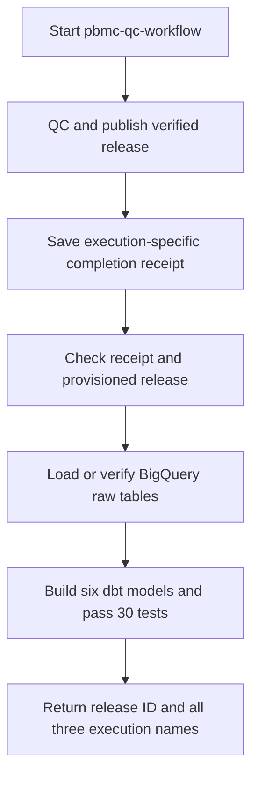

# One workflow for QC, warehouse loading and dbt

Stage 4, substep 3 connects the three verified jobs. One manual workflow
invocation now runs the complete chain in order for a provisioned release.



## Exact release handoff

Cloud Run returns platform execution metadata rather than the Python worker's
result. The QC wrapper therefore writes a small JSON completion receipt at
`gs://pbmc-okf-portfolio-data/runs/handoffs/qc/<CLOUD_RUN_EXECUTION>.json`.
It is published only after the release and both kinds of QC audit are durable.
The receipt contains schema version 1, success status, the Cloud Run execution
name, release ID, manifest URI and manifest SHA-256. It is create-only and
verified by readback. Content excludes attempt UUIDs, allowing retries of the
same Cloud Run execution to reuse identical receipt bytes.

The workflow waits for terminal QC success, derives the object name from that
specific returned execution, reads its metadata and fetches that exact object
generation. It requires a JSON object with the supported version, success
status, matching execution, provisioned release ID and matching manifest URI.
It then passes the receipt's release ID through execution-specific argument
overrides to the loader and dbt. Each downstream worker independently verifies
the committed release; dbt also checks the complete raw table contents.

The provisioned release is
`71a4bb4d026366b644c4aaf8bd4b29d8f8f87fe1701ba2e8d6a88ba164b83f7d`.
An unexpected release stops before warehouse loading. Provision its analytics
dataset and dataset-level grants, and update the workflow's release selection
before accepting a different producer release. Retain existing release datasets
when expanding the Terraform configuration; they have destruction protection.

`Dockerfile.qc-workflow` adds the receipt-enabled wrapper and shared download
helper on top of the previously verified QC image. The producer's three core
code hashes and package/runtime versions stay unchanged. A Linux smoke check
confirmed the same release ID. The new QC image is pinned by OCI index digest
`sha256:61b525d54223a968d0625656abdebf2c6e50a50a55060494900b4a8a1b7dd052`.
The loader and dbt keep their independently verified image digests.

## Access, failures and outputs

The workflow identity can invoke/read QC; execute with overrides and read only
the two downstream jobs; and read only QC handoff objects. It has no BigQuery
access or bucket write grant. Data access stays with the three worker accounts.
The override role includes execution cancellation, but this workflow does not
automatically cancel jobs. It cannot replace a job's command, image or identity.

Execution is sequential. A missing/malformed receipt, unexpected release,
failed job or connector timeout stops progression. No explicit retry wraps a
job-start call. Each job retains one task retry. Connector timeouts allow both
attempts: 2,100 seconds for QC/loading and 2,700 seconds for dbt. A connector
timeout does not itself cancel a running Cloud Run task. Failed dbt builds may
leave partial analytics; rerun after diagnosis, and accept results only after
terminal success and passing tests. Run one chain at a time for this release
because its dbt models are rebuilt in place. No scheduler or automatic trigger
is configured. The [failure/retry drills and recovery runbook](009-pipeline-operations.md)
complete substep 4. Later operations work includes alerts, schedules and concurrency controls.

The workflow name remains `pbmc-qc-workflow`; its result is now a summary with
`status`, `release_id`, `analytics_dataset`, `qc_execution`, `warehouse_execution`,
`dbt_execution`, `handoff_uri` and `handoff_generation`. Older tooling expecting
the entire QC execution object must use these new summary fields.

```powershell
gcloud.cmd workflows run pbmc-qc-workflow `
  --project=pbmc-okf-portfolio --location=europe-west1
```

## Validation

All 94 Python tests passed, including receipt retry reuse, processing failure,
audit delivery failure and receipt delivery failure. Terraform validation,
workflow YAML parsing and Linux dependency/producer identity smoke checks passed.
The deployment plan added five scoped IAM grants and updated three resources,
with no deletions.

Live full-chain execution on 2026-11-01 reached `SUCCEEDED` in 180 seconds:

- Workflow execution: `ddf27d7a-2215-4003-9d78-f6bcfdd2cea7`.
- Workflow revision: `000003-845`.
- QC: `pbmc-qc-k6wwc`.
- Warehouse loader: `pbmc-warehouse-load-6bwbl`.
- dbt: `pbmc-dbt-build-nn8hk`.
- QC receipt generation: `1793534688601638`.

Terraform's final formatting, validation and drift checks passed with no changes.

Independent verification confirmed the workflow identity started all three
jobs, each job used its dedicated runtime identity, and each stage began after
the preceding execution completed. The generation-pinned receipt matched QC's
release and manifest checksum. All three durable audits matched their structured
logs. The loader's complete raw-table contents matched the verified release;
it reused all three tables without new load jobs. All five published release
object generations matched the original cloud baseline.

Downloaded dbt artifacts contained six successful models and 30 passing tests.
Queries across all six models confirmed only the selected release, with
2,700 staging cells, 32,738 staging genes, one summary, one QC mart, four
exclusion rows and 2,638 QC-passing cohort cells. The QC mart reconciled
2,700 total cells, 2,638 passes, 62 failures and 6,390,631 counts.
Generated local evidence is in `artifacts/pipeline_execution.json` and
`artifacts/pipeline_verification.json`, excluded from Git.

## Knowledge extension

Stage 5.5 adds an execution-bound dbt receipt and the knowledge worker after this
three-stage baseline. The workflow now returns the verified knowledge package ID
and publication URI. See [cloud knowledge automation](014-cloud-knowledge.md) for
the additional receipts, runtime identities, permissions and retry boundary.

## References

- [Workflows Cloud Run job connector](https://docs.cloud.google.com/workflows/docs/reference/googleapis/run/v1/namespaces.jobs/run).
- [Execution-specific argument overrides](https://docs.cloud.google.com/run/docs/reference/rest/v1/namespaces.jobs/run).
- [Cloud Run execution roles](https://docs.cloud.google.com/iam/docs/roles-permissions/run).
- [Generation-specific Cloud Storage reads](https://docs.cloud.google.com/storage/docs/json_api/v1/objects/get).
