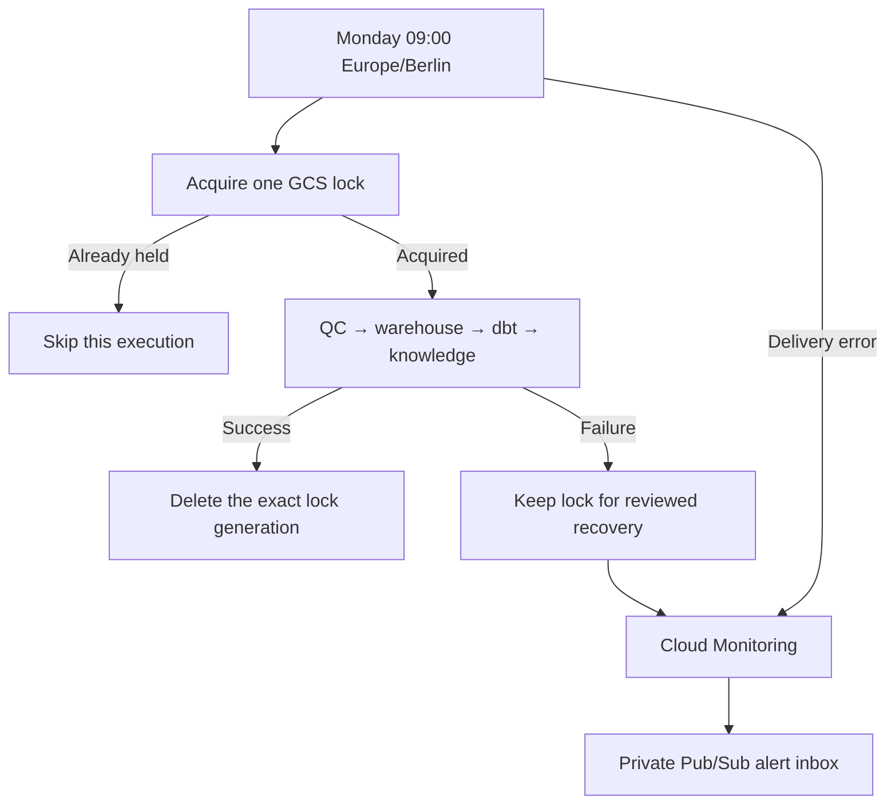

# Stage 7: scheduled operation, concurrency protection and private alerts

The production pipeline now has a weekly trigger, an atomic lock, failure
notifications and an explicit lock-recovery command. Actual-money reporting is
implemented separately and awaits the billing-export setup described in
[the cost guide](022-actual-cost-reporting.md). It is not reported as completed
until real exported usage rows are available.



## Schedule and manual inspection

The active job is **`pbmc-weekly-pipeline`**, cron `0 9 * * 1`, timezone
`Europe/Berlin`. The fixed public source dataset does not need daily ingestion.
The scheduled run verifies the current release and creates a new checked dbt and
knowledge version. It does not automatically change the assistant's bundled pin.

Open [Cloud Scheduler](https://console.cloud.google.com/cloudscheduler?project=pbmc-okf-portfolio)
and inspect the job's schedule, OAuth account, last attempt and target. The
target is the Workflows executions API. Scheduler uses OAuth, not a Cloud Run
OIDC audience. See [Google's scheduling guide](https://docs.cloud.google.com/workflows/docs/schedule-workflow).

The account `pbmc-scheduler@pbmc-okf-portfolio.iam.gserviceaccount.com` has a custom
role containing only `workflows.executions.create`. Workflows grants are
project-scoped; this is not a single-workflow IAM boundary. The account cannot
read/cancel executions or directly run Cloud Run jobs through this role. Its
configured target is the guarded production workflow.

To request one immediate run:

```powershell
gcloud scheduler jobs run pbmc-weekly-pipeline --location europe-west1 --project pbmc-okf-portfolio
```

A successful Scheduler request only proves delivery of a workflow-start request.
It does not wait for all four jobs. In [Workflows](https://console.cloud.google.com/workflows?project=pbmc-okf-portfolio),
open `pbmc-qc-workflow`, inspect the execution state and expand the `pipeline`
subworkflow. Check the successful result's exact execution receipts and knowledge
publication URI. Never count HTTP delivery success alone as pipeline success.

Pause recurring runs through the Terraform `pipeline_schedule_paused` variable
and a reviewed plan/apply. The emergency `gcloud scheduler jobs pause` command is
also available; reconcile that change with Terraform afterward. Do not directly
run the four production jobs while a guarded run or recovery is in progress.

## What the lock guarantees

The lock is the small GCS object
`gs://pbmc-okf-portfolio-data/operations/locks/production-pipeline.json`.
GCS accepts its creation only with `ifGenerationMatch=0`: one contender acquires
it, and overlapping workflow executions return `skipped_lock_held` before
starting any pipeline job. The original production pipeline steps and arguments
are preserved unchanged inside the guarded subworkflow.

The lock records the workflow execution UUID. A successful run deletes only its
acquired generation. There is no expiry or automatic stealing. Failure,
cancellation or an uncertain request outcome can retain the lock; this prevents
a later run from assuming that old Cloud Run tasks have stopped.

This serializes the guarded entrypoint. Administrators can bypass it by directly
running jobs. It does not provide exactly-once Scheduler occurrence processing:
delayed duplicate delivery after a completed run can produce another run/version.
Explicit HTTP retries are disabled, but that is not an exactly-once guarantee.

The runtime's custom role permits get/create/delete only, with an IAM condition
on this exact object. It does not grant deletion of releases, receipts, knowledge
versions or the Terraform state bucket. An isolated guard workflow uses a
different object in the drill bucket and cannot execute data jobs.

## Recover a retained lock

1. Read the object and its current generation. Record the owner UUID and inspect
   that exact workflow execution.
2. Investigate its failure. Cancellation of a workflow does not imply cancellation
   of Cloud Run tasks; inspect all four jobs and wait until their executions end.
3. Use the recovery command with the exact inspected owner and generation:

```powershell
$env:PYTHONPATH = 'src'
.\.venv\Scripts\python.exe -m pbmc_platform.recover_pipeline_lock `
  --target production --owner REPLACE_WITH_UUID --generation REPLACE_WITH_GENERATION
```

The command refuses changed owners/generations, nonterminal owners, missing
evidence and any Cloud Run execution without completion time. It follows all
execution-list pages. Deletion is generation-conditional, so a replaced lock
cannot be removed using stale recovery inputs. Correct the underlying problem
before requesting a new pipeline run. Do not use an unconditional object delete
or infer safety from a lock's age. Run one administrative recovery at a time.

## Private notification delivery

Cloud Monitoring has two log-based policies: **PBMC pipeline failure** for error
logs on the production/isolated guard workflows, and **PBMC Scheduler delivery
failure** for Scheduler error logs. The latter covers a request that never
starts a workflow. Notification rate limiting is five minutes per policy and
inactive incidents auto-close after 30 minutes.

Both publish to topic `pbmc-operations-alerts`. Subscription
**`pbmc-operations-alert-inbox`** retains unacknowledged messages for seven days.
The Monitoring notification service agent has publish access only to this topic.
No email, Slack or third-party recipient is configured. Receiving a message in
the private inbox is not proof that a human read it.

Inspect policies/incidents in [Monitoring](https://console.cloud.google.com/monitoring/alerting?project=pbmc-okf-portfolio),
or pull the inbox:

```powershell
gcloud pubsub subscriptions pull pbmc-operations-alert-inbox --project pbmc-okf-portfolio --limit 10 --format=json
```

Without auto-ack, messages can be delivered again. The acceptance drivers
acknowledge only the notifications that match their own deliberate test failures.
Acknowledging Pub/Sub does not close a Monitoring incident. Intentional drill
incidents remain visible as test evidence until they auto-close.

`pbmc-scheduler-failure-drill` normally remains paused and points to a confirmed
nonexistent workflow. Its driver briefly enables it, requests one immediate
dispatch, verifies the exact 404 failure and resulting private alert, then
restores pause. It never targets a production data job.

## Reproduce acceptance

```powershell
.\.venv\Scripts\python.exe -m ops.run_operations_checks --production
.\.venv\Scripts\python.exe -m ops.check_scheduler_failure
```

Run one suite at a time. The first command injects only isolated lock faults,
then triggers the real production Scheduler once. It verifies the committed
knowledge bundle, validation evidence and exact cohort after completion. The
second tests a failed Scheduler delivery through the same notification inbox.

If checking times out after Scheduler accepted the request, inspect the recorded
report and existing execution before retriggering. Scheduler's first dispatch
can be delayed. The checker allows ten minutes for dispatch, requests the full
execution view for arguments, and can verify an existing run without another
dispatch:

```powershell
.\.venv\Scripts\python.exe -m ops.run_operations_checks `
  --resume-production artifacts/operations/RUN/report.json --execution EXISTING_UUID
```

Resume requires the six isolated workflow checks and real alert delivery to have
passed, and verifies the selected execution's scheduled trigger and timestamp.

## Remaining limits

There is no independent absence-of-success/heartbeat alarm, production SLO,
guaranteed human notification receipt or automatic remediation. Cancellation
retention is tested on an isolated sleeping workflow; live cancellation/timeout
of actual Cloud Run data tasks remains outside this evidence. The recovery tool
does independently reject active tasks, including after workflow cancellation.
Actual spend and cost-saving claims await billing data. Credentials, raw billing
data, execution reports and Terraform state stay outside GitHub.

## Accepted results: 2026-11-05

| Check | Accepted evidence |
| --- | --- |
| Atomic contention | Owner `caa17798-4e06-4c01-bee1-d4eca9ed7f9b` succeeded; contender `e9ad404a-b047-4f59-8179-1a311a23fd40` skipped |
| Failed run retains its lock | `48de47ef-e326-4342-9cd9-2c4e7f84c21a` failed for the exact injected reason; `eb262f76-632a-4a7f-89d9-da17a9c0bb8d` skipped without changing its generation |
| Cancellation retains lock | `39fe26d8-0ee5-4042-8053-86ff72d58568` cancelled; inspected generation was recovered explicitly |
| Healthy recovery | `c69b3c50-97f6-468e-a3c5-cfb9176bd7f5` succeeded and released the lock |
| Workflow failure notification | Pub/Sub message `23082201450364026`, incident `0.oenomwvc4chb`, correlated to the injected failure execution |
| Scheduled production completion | `d9ced541-0f8c-445b-9623-8a5417073776` succeeded on workflow revision `000005-b62`; committed bundle readback and exact 2,638-cell cohort verified |
| Scheduler failure notification | Missing target returned an observed HTTP 404 (Scheduler status code 5); message `23276006880447360`, incident `0.oenp9lq4r2ao`; drill restored to paused |

The production run used `pbmc-qc-97h9x`, `pbmc-warehouse-load-k9kks`,
`pbmc-dbt-build-dbx9n` and `pbmc-knowledge-build-k8dnb`. Its new knowledge package
is `f5b2d95bbd10b1098b5d6d9a11e54d48c3d18ee55dbdaca95464508bc55c8c1c`.
The assistant's previously accepted snapshot is unchanged.

All **352 project tests passed**. Terraform formatting/validation passed. The
new lock role initially needed time to propagate to Storage; a refreshed plan
completed the remaining grants before either guarded workflow or the production
schedule was enabled. The final deployment adds 22 operations resources, wraps
only the existing production workflow, and destroys nothing. The original
pipeline steps and arguments were compared structurally and preserved exactly.
Scheduler's zero-retry block includes explicit backoff defaults so provider
refresh does not continually propose an empty-block update.

The initial production checker timed out before Scheduler's delayed first
dispatch. Acceptance resumed against that same existing workflow and fetched its
full execution view; no second production run was requested. The report retains
the earlier verification failure rather than treating dispatch timeout as a
pipeline failure or counting an unchecked run as success.

See [the portable evidence summary](../examples/operations-evidence.json). Full
local reports are `artifacts/operations/20261105T095724Z/report.json` and
`artifacts/scheduler_failure_verification.json`. The summary records their hashes,
real execution IDs, notification IDs, cohort count and the pending billing-data
status. Stages 7.1–7.3 are accepted; Stage 7.4 actual-money reporting remains
pending export configuration/data, with its dataset and tested reporter ready.
