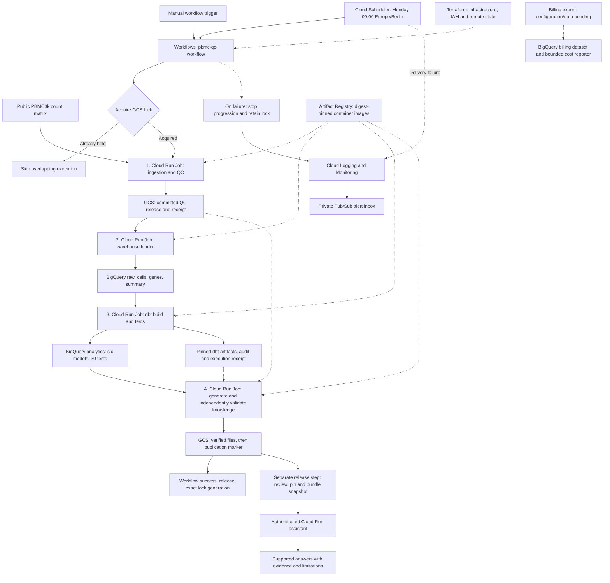
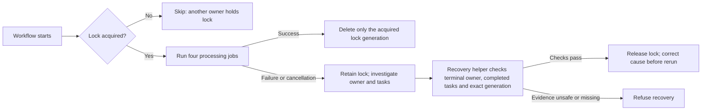

# PBMC knowledge platform: rationale, utility and complete pipeline flow

This project turns a public single-cell dataset into reproducible quality-control
results, tested SQL analytics and a verified knowledge package that a small
evidence assistant can explain. It demonstrates how to build and operate a
traceable data product on Google Cloud, from acquisition through consumption.

This document describes the implemented portfolio release as of **5 November
2026**. Stages 1–6 and operations steps 7.1–7.3 are accepted. Actual cost reporting
in step 7.4 awaits billing-export data; the dataset and reporter are ready.

## 1. The idea in everyday language

Think of the platform as a laboratory with a careful record keeper:

1. Receive a known dataset and check that the file is the expected one.
2. Measure the quality of every cell and record why a cell passes or fails.
3. Put the measurements into tables that can be queried with SQL.
4. Build useful summaries and test that their numbers agree.
5. Package the checked results together with their sources and limitations.
6. Let a user ask supported questions and see answers tied to that evidence.

The important product is a result that can be explained and traced back to its
input, processing policy and successful execution.

## 2. Why build this, and who benefits?

The intended user is a scientist exploring public peripheral blood mononuclear
cell (**PBMC**) data and its quality constraints. A count matrix alone does not
explain which cells meet a chosen quality policy, what was excluded or which
processing run produced a summary. This pipeline makes those decisions explicit.

| User or reviewer | Utility |
| --- | --- |
| Scientist | Inspect dataset size, QC results, exclusion reasons and limitations without reconstructing every processing step. |
| Data analyst | Query consistent cell/gene metadata and tested summary tables with SQL. |
| Data engineer | Reproduce a release, investigate failures and retry processing without blindly appending duplicate raw data. |
| Portfolio reviewer | Inspect concrete evidence of orchestration, contracts, IAM, validation, recovery and data-product delivery. |

The dataset is deliberately small. That makes it practical to check complete
table contents and independently recompute results. The project demonstrates
engineering depth; it does not establish large-scale throughput or clinical
validity.

## 3. Input and scientific scope

The source is the public **10x Genomics PBMC3k** dataset, using the unnormalized
AnnData count-matrix copy supplied through Scanpy. The `.h5ad` file contains a
sparse matrix: rows represent cells, columns represent gene features, and values
represent observed counts. It is already a gene-barcode count matrix; this
pipeline starts after sequencing-read alignment and counting.

| Property | Recorded value |
| --- | --- |
| Dataset | `10x_pbmc3k` |
| Dataset version | `cellranger-1.1.0-hg19-scanpy-v1` |
| Organism / tissue | Human / blood |
| Donors / reference genome | One healthy donor / hg19 |
| Input dimensions | 2,700 cells × 32,738 features |
| Source file | `https://falexwolf.de/data/pbmc3k_raw.h5ad` |
| Input SHA-256 | `89a96f1beaa2dd83a687666d3f19a4513ac27a2a2d12581fcd77afed7ea653a1` |
| Attribution and licence | 10x Genomics, CC BY 4.0 |

The source configuration is [dataset.yaml](../configs/dataset.yaml). The platform
does not infer cell types, perform differential expression or support disease
comparisons. Passing QC means meeting the recorded technical policy; it does
not establish a biological label or scientific conclusion.

## 4. Complete visual flow

Solid arrows show processing or delivery. Dotted arrows show supporting controls
or evidence inputs. The four processing jobs run sequentially inside Workflows.
The assistant is built and deployed separately from a selected publication.



The workflow also checks the execution-specific receipts between jobs. A Cloud
Run success status alone is insufficient to identify the correct downstream
data. The receipt links that execution to its exact release or dbt invocation.

## 5. What each processing step does and why

### Step 1: acquire the input, calculate QC and commit a release

**Job:** `pbmc-qc`. The worker checks the configured input checksum, validates the
matrix and calculates per-cell metrics such as total counts, detected genes and
mitochondrial count percentage. Gene names starting with `MT-` identify
mitochondrial features under this policy.

A cell passes only when it has nonzero counts and meets the recorded thresholds:

| QC rule | Passing condition | Why record it? |
| --- | --- | --- |
| Detected genes | At least 200 and fewer than 2,500 | Makes the chosen low/high complexity boundaries explicit. |
| Mitochondrial count percentage | Less than 5% | Applies the selected technical quality threshold consistently. |
| Zero counts | Excluded | Prevents a cell with no observed counts from entering the passing cohort. |

These are the project's demonstration thresholds, not universally suitable
thresholds for every experiment. [qc.yaml](../configs/qc.yaml) defines them;
the release records the policy used so later configuration edits do not rewrite
the meaning of old results.

The output includes cell, gene and summary Parquet tables, a release manifest,
checksums and audit evidence. The sparse expression matrix remains outside the
warehouse. Publication uses create-only writes and a final completion marker,
so downstream readers can distinguish a committed release from a partial upload.

**Rationale:** a checksum identifies the acquired file, while the release identity
also binds the processing configuration and recorded code/runtime identity.
This makes reproducibility more meaningful than using a filename such as
`latest.csv`.

### Step 2: load a verified release into BigQuery

**Job:** `pbmc-warehouse-load`. The loader validates the selected committed
release and loads three release-specific tables into `pbmc_raw`:

- `cells_r_<release_id>`: every input cell, its metrics, QC flags and reasons.
- `genes_r_<release_id>`: gene identifiers and annotations.
- `dataset_summary_r_<release_id>`: the producer's recorded dataset summary.

The loader checks schemas, keys, counts and complete remote row contents. It
reuses tables that already match and uses `WRITE_EMPTY` for loads into empty
tables. Conflicting nonempty data causes a failure instead of an overwrite.

**Rationale:** raw metadata stays available for audit, including failed cells.
Retries do not append another copy of the same release. The expression matrix
is not expanded into a large cell-by-gene SQL table when the current product only
needs QC metadata and summaries.

### Step 3: build and test SQL analytics with dbt

**Job:** `pbmc-dbt-build`. dbt builds six models in
`pbmc_analytics_r_<release_id>` and runs 30 data tests in the accepted build.

| Model | Function |
| --- | --- |
| `stg_cells` | Standardized metadata, QC metrics, flags and reasons for all cells. |
| `stg_genes` | Gene identifiers and mitochondrial/source annotations. |
| `stg_dataset_summary` | Original producer summary for comparison. |
| `mart_dataset_qc` | Recomputed counts, means and QC pass fraction. |
| `mart_qc_exclusions` | Counts for the four exclusion reasons. |
| `mart_cohort_cells` | Exact set of cells passing the recorded QC policy. |

Tests check keys, nulls, metric invariants and agreement between producer,
warehouse and cohort results. The worker publishes dbt artifacts and an audit;
its completion receipt identifies the successful invocation.

**Rationale:** SQL transformations are reviewable and testable independently of
the Python producer. Release-specific datasets separate releases. Within one
release, dbt rebuilds models in place, so downstream stages must wait for the
successful tested build rather than consume partial results.

### Step 4: generate, independently validate and publish knowledge

**Job:** `pbmc-knowledge-build`. The generator creates a draft JSON package from
the selected release, analytics and successful dbt evidence. It includes dataset
identity, policy, results, exclusions, source references and limitations.

The validator checks both structure and meaning. It verifies pinned artifacts,
recomputes metrics from the source matrix, checks raw rows and analytics, and
compares the exact passing cohort. A draft cannot become trusted merely by
changing its status field to `verified`.

After validation, the publisher writes:

```text
gs://pbmc-okf-portfolio-data/knowledge/releases/<release_id>/<package_id>/
  knowledge.json       # Machine-readable facts and evidence references
  report.md            # Readable explanation generated from those facts
  validation.json      # Recorded validation evidence
  publication.json     # Completion marker, written last
```

The marker records file generations, checksums and sizes. Existing identical
objects can be reused; conflicting bytes are rejected. Consumers require the
marker and verify its referenced files rather than trusting a folder's presence.

**Rationale:** the package gives consumers a stable, bounded evidence interface
without requiring them to interpret every source table. Here, **OKF** means this
project's versioned JSON knowledge format; it does not claim conformance to an
external Open Knowledge Format standard.

### Step 5: serve a reviewed evidence snapshot through the assistant

**Service:** `pbmc-assistant`. A separate build selects a verified publication,
pins it and bundles the checked files into the assistant image. A new pipeline
publication does **not** automatically change the assistant's answers.

The assistant supports six topics: dataset summary, QC results, exclusions,
policy, dbt evidence and limitations. Deterministic routing accepts supported
questions and returns answers with evidence references. Unsupported or ambiguous
questions receive an unsupported response. No language model is used.

**Rationale:** a reviewed snapshot makes the served answers reproducible and
keeps runtime data permissions small. The cloud service requires authentication;
its runtime account has no data-access roles. Local operation can use the
archived verified bundle without cloud credentials.

## 6. Resources and why they exist

The project ID is **`pbmc-okf-portfolio`**. The processing region is
**`europe-west1`**; the separate billing-export dataset is in the **EU**
multi-region.

| Resource | Use in this project | Design rationale |
| --- | --- | --- |
| Cloud Storage: `pbmc-okf-portfolio-data` | Input cache, committed releases, receipts, audits, knowledge packages and pipeline lock. | Durable object evidence with generation-specific reads and conditional writes. |
| BigQuery: `pbmc_raw` | Release-specific metadata and summary tables. | Queryable source records for SQL processing and audit. |
| BigQuery: `pbmc_analytics_r_<release_id>` | dbt staging models and marts. | Analytics isolated by full release identity. |
| Four Cloud Run Jobs | QC, loading, dbt and knowledge processing. | Containerized batch tasks with separate identities and bounded resources. |
| Workflows: `pbmc-qc-workflow` | Runs all four jobs in order and verifies handoffs. | Explicit dependencies, execution history and failure boundaries; the legacy name covers the full chain. |
| Cloud Scheduler: `pbmc-weekly-pipeline` | Triggers the guarded workflow every Monday at 09:00 Europe/Berlin. | Regular verification of a fixed public dataset without an unnecessary daily schedule. |
| Artifact Registry: `pbmc-containers` | Stores worker and assistant images. | Runtime references are pinned by digest, making the chosen image explicit. |
| IAM service accounts and scoped roles | Separate orchestration, scheduling, data processing and serving identities. | Each component receives the access needed for its own function. |
| Cloud Logging and Cloud Monitoring | Structured execution evidence and failure policies. | Makes processing failures and Scheduler delivery failures visible. |
| Pub/Sub topic and private inbox | `pbmc-operations-alerts` and `pbmc-operations-alert-inbox`. | Receives Monitoring notifications without a third-party messaging dependency. |
| Cloud Run service: `pbmc-assistant` | Authenticated browser and answer interface. | Delivers a usable data product from a reviewed evidence snapshot. |
| Terraform and GCS state backend | Infrastructure/IAM configuration; state in `pbmc-okf-portfolio-tfstate`. | Reviewable infrastructure changes and persistent shared deployment state. |
| BigQuery: `pbmc_billing_export` and cost reporter | Prepared destination and service/date cost reporting with credits. | Enables measured usage-cost reporting once real billing export is configured and populated. |

Terraform provisions resources; it does not perform the scientific processing.
Artifact Registry supplies code images; it does not hold the dataset releases.
Workflows coordinates jobs; the workers perform the data reads and writes.

## 7. How a result stays traceable

Three identities answer different questions:

| Identity | Question it answers |
| --- | --- |
| Release ID | Which input, recorded policy and producer identity define these QC outputs? |
| Execution / dbt invocation ID | Which particular run completed this processing step? |
| Knowledge package ID | Which verified files and validation evidence form this publication? |

The workflow selects an execution-specific QC receipt and reads its exact GCS
generation. It requires the provisioned release before starting downstream work.
The dbt receipt binds the knowledge worker to that workflow's successful dbt
execution and invocation. The final knowledge receipt identifies the completed
publication. There is no implicit selection of a global cloud `latest` package.

For the accepted cloud release, the full release ID is:

```text
71a4bb4d026366b644c4aaf8bd4b29d8f8f87fe1701ba2e8d6a88ba164b83f7d
```

## 8. Scheduling, failures and recovery

Before starting any processing job, the workflow tries to create one lock object
with a create-only generation precondition. Only one overlapping execution can
acquire it. A contender returns `skipped_lock_held` without starting data jobs.



There is no automatic lock expiry or stealing. Cancelling a workflow does not
prove that its Cloud Run tasks have stopped. The recovery helper checks the
recorded owner, exact generation and job completion before conditional deletion.

Pipeline error logs and Scheduler delivery errors feed separate Monitoring
policies that notify the private Pub/Sub inbox. A successful Scheduler delivery
only means a workflow-start request was accepted; it does not prove that the
pipeline finished successfully.

Retries verify and reuse matching committed artifacts. A failed dbt build may
leave partial models, and an incomplete publication may leave some files.
Downstream consumers accept only successful tested builds and complete verified
publications. These controls are not a cross-service transaction or an
exactly-once scheduling guarantee. Direct administrative job runs can bypass
the workflow lock.

## 9. What has actually been demonstrated

The accepted dataset results are:

| Metric | Value |
| --- | ---: |
| Total cells | 2,700 |
| QC-passing cells | 2,638 |
| QC-failing cells | 62 |
| Features | 32,738 |
| Total counts across input cells | 6,390,631 |
| Mitochondrial features | 13 |
| Zero-count / low-gene exclusions | 0 / 0 |
| High-gene / high-mitochondrial exclusions | 5 / 57 |

Exclusion reasons can overlap in general. Their sum must not be used as a
universal substitute for counting the union of failing cells.

The latest recorded full Python suite passed **352 tests**. The accepted dbt
build passed **six models and 30 data tests**. The assistant passed **60 cloud
regression cases**; these are a bounded authored test set, not a general-language
benchmark. Live isolated drills exercised failure/retry behavior and lock
contention, failure retention, cancellation retention and recovery. Real
Monitoring notifications reached the private inbox for deliberate workflow and
Scheduler failures.

The scheduled production workflow execution
`d9ced541-0f8c-445b-9623-8a5417073776` succeeded on 5 November 2026. Acceptance
verified the committed knowledge bundle and the exact 2,638-cell cohort. See
[operations evidence](../examples/operations-evidence.json) for the portable
record. These are recorded acceptance results, not a claim that tests were rerun
when this document was written.

## 10. Boundaries, tradeoffs and remaining work

Complete readback and independent recomputation provide strong checks for this
bounded dataset, but add work and query cost. Larger data would require a
different validation strategy and measured performance testing. The current
implementation does not establish streaming support, high availability or a
production freshness SLO.

Create-only publication is an application protocol, not a bucket retention lock
or cryptographic signature. Administrators with broader permissions can still
change cloud resources. Scoped worker accounts and generation/checksum checks
reduce accidental misuse within the intended execution path.

There is no independent absence-of-success alarm or configured email recipient.
Private notification delivery was verified; human receipt was not. Cancellation
retention was tested on an isolated workflow, not by cancelling a live production
data task.

**Actual spend remains unknown from this repository's billing data.** The billing
dataset currently has no export table. Once Standard usage cost export is enabled
and rows arrive, the reporter can group this project's exported costs by service,
date and currency, including credits. Query-byte caps are not monthly spending
caps, and exported usage records can lag or receive adjustments. No measured
cost-saving claim is made.

## 11. Where to inspect the implementation

| Area | Repository entry points |
| --- | --- |
| Dataset and QC rules | [Dataset configuration](../configs/dataset.yaml), [QC configuration](../configs/qc.yaml), [QC guide](002-qc-pipeline.md) |
| Acquisition and QC | [ingestion.py](../src/pbmc_platform/ingestion.py), [qc.py](../src/pbmc_platform/qc.py), [cloud QC worker](../src/pbmc_platform/run_cloud_qc.py) |
| Warehouse and SQL | [Loader](../src/pbmc_platform/load_warehouse.py), [dbt project](../warehouse/dbt), [warehouse guide](003-warehouse.md) |
| Orchestration | [Pipeline template](../infra/pipeline.yaml.tftpl), [guard template](../infra/pipeline_guard.yaml.tftpl), [Workflows Terraform](../infra/workflows.tf) |
| Knowledge contract and validation | [Schema](../schemas/pbmc-knowledge-v1.schema.json), [generator](../src/pbmc_platform/generate_knowledge.py), [validator](../src/pbmc_platform/validate_knowledge.py) |
| Publication | [Publisher](../src/pbmc_platform/publish_knowledge.py), [publication guide](013-knowledge-publication.md), [cloud knowledge guide](014-cloud-knowledge.md) |
| Assistant | [Answer engine](../src/pbmc_platform/assistant.py), [question routing](../src/pbmc_platform/question_routing.py), [browser interface](../src/pbmc_platform/assistant_web.py), [cloud access guide](020-cloud-assistant.md) |
| Operations | [Terraform resources](../infra/operations.tf), [recovery helper](../src/pbmc_platform/recover_pipeline_lock.py), [operations runbook](021-operations.md) |
| Costs | [Reporter](../src/pbmc_platform/report_costs.py), [billing export setup](022-actual-cost-reporting.md) |
| Reviewable output | [Archived verified report](../examples/pbmc-verified-report.md), [portfolio walkthrough](016-portfolio-walkthrough.md) |

To read this document with diagrams in VS Code, open it and select **Open Preview
to the Side** (`Ctrl+K`, then `V`). Mermaid rendering depends on the Markdown
preview's support; GitHub renders the Mermaid blocks when viewing the committed
file. All pipeline steps are also explained in text and tables above.
